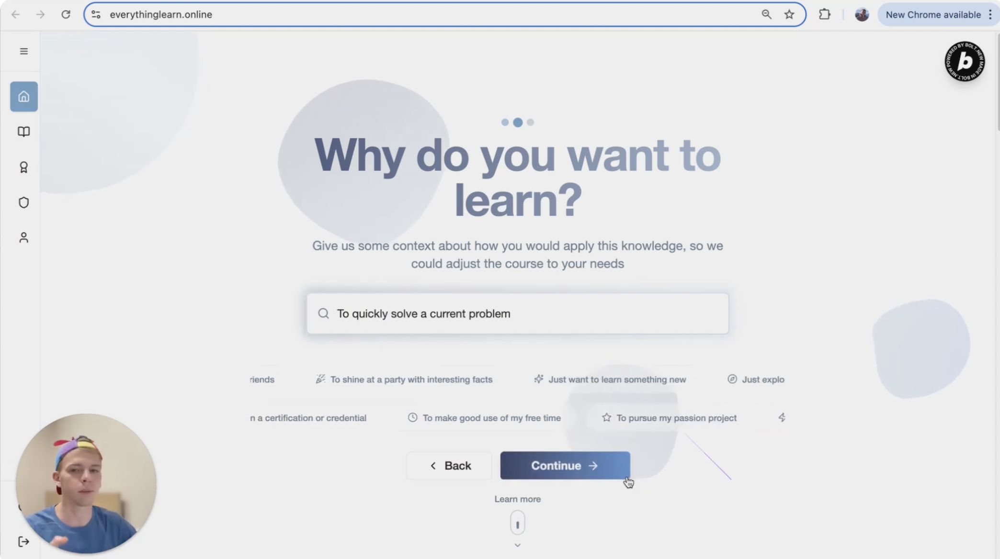
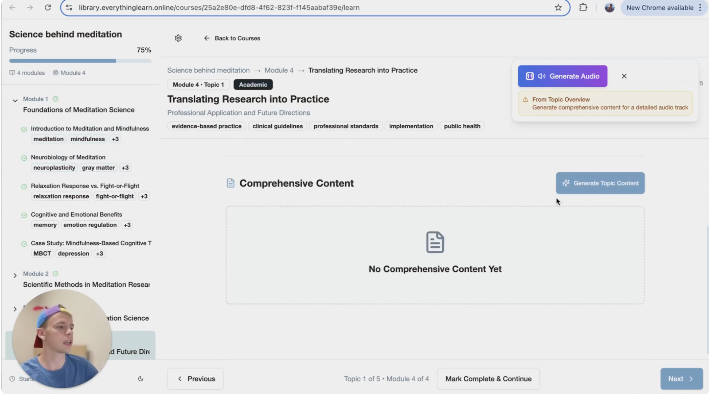

<div align="center">


# Orion's Path

### Learn anything. Structured by AI, verified on-chain.

*Pick a topic, pick a depth, and get a full course built for you in minutes. Finish it and earn a certificate nobody can fake.*


</div>

<p align="center">
  
  
</p>
<p align="center"><sub>Left: the guided course-creation flow. Right: the learning view with progress tracking, topic keywords and on-demand content.</sub></p>

---

## Why this exists

I was tired of reading dense technical documentation that wasn't written for where I was in my learning. Plain AI chat wasn't the answer either. It gives you a wall of text, with no structure, no progression and no way to track what you've covered.

So I built the missing middle: **AI that generates a real curriculum**, with modules, topics, depth control and progress tracking, and a credential at the end that actually means something.

## What it does

### 1. Describe what you want to learn
A guided, animated flow asks for your **topic**, your **existing context** and a **depth from 1 to 5**. A quick overview and a deep dive are different courses, so they're generated differently.

### 2. Get a complete syllabus
An AI pipeline produces a structured course of modules and topics tailored to you. Requests pass through **OpenAI content moderation** before anything is generated.

### 3. Study with content generated on demand
Lesson content is generated per topic, in the background, **with source citations**. You see live ready / generating / failed states instead of a spinner and a prayer. Progress is tracked across every course you enroll in.

### 4. Earn a certificate that can't be forged
Complete a course and your certificate is anchored on the **Algorand blockchain**. Anyone can verify it on a public verification page, with no account and no trust in me required.

## Highlights

- **Asynchronous AI job pipeline.** Syllabus and content generation run as Supabase Edge Functions (Deno) fed by Postgres triggers, so the UI stays fast while heavy generation happens in the background.
- **Two-stage generation.** A syllabus job builds the course structure, then a separate content job fills in each topic. Both are retryable and track their own status.
- **Blockchain credentials.** An Algorand smart-contract client with a certificate service, a verification widget, a certificate viewer and a public verify page.
- **Safety built in.** Moderation runs on course requests before generation.
- **Polished UI.** Shooting-star hero, comic-panel origin story, animated roadmap, dark/light themes, a responsive layout with a mobile shell, and a full shadcn/ui component set.
- **Real data layer.** 18 SQL migrations with row-level security, enrollments, jobs, certificates and profiles.

## Tech

| Layer | Stack |
| --- | --- |
| Frontend | React 18, TypeScript, Vite, Tailwind CSS, shadcn/ui, Framer Motion |
| Backend | Supabase: Postgres, Auth, Edge Functions (Deno), DB triggers |
| AI | Perplexity (generation), OpenAI (moderation) |
| Blockchain | Algorand via `algosdk` and AlgoKit utils |

## Architecture

```
 Browser (React) ──► Supabase (Auth + Postgres)
                          │  insert course / job row
                          ▼
                  DB trigger ──► Edge Function: process-syllabus-job ──► Perplexity (+ OpenAI moderation)
                          │
                          └────► Edge Function: process-content-job ──► Perplexity
                                           │
                       results written back, UI updates ◄─┘

 Course completed ──► Algorand certificate contract ──► public verify page
```

## Roadmap

The landing page lays out the full journey. Today the first two steps and the certificates are built. The rest is designed and next up.

- [x] **Generate your course.** Topic, context and depth produce a syllabus.
- [x] **Study and learn.** On-demand content, citations and progress tracking.
- [x] **Certificate.** Algorand-verified and publicly checkable.
- [ ] **Audio version.** Your course as an AI-generated podcast (ElevenLabs).
- [ ] **Video tutor session.** A closing conversation with an AI tutor (Tavus), a friendly chat for easy courses and a real knowledge check for hard ones.

## Status

The hosted demo and its database are currently **offline**. The code is here so you can read it, run it against your own Supabase project, or borrow ideas.

## Run it yourself

```bash
npm install
cp .env.example .env      # add your Supabase + Algorand values
npm run dev
```

Deploy your own backend:

```bash
npx supabase link --project-ref <your-ref>
npx supabase db push
npx supabase functions deploy process-syllabus-job
npx supabase functions deploy process-content-job
npx supabase secrets set PERPLEXITY_API_KEY=... OPENAI_API_KEY=...
npm run blockchain:deploy   # optional: deploy the certificate contract
```

Some migrations call the Edge Functions over HTTP and contain placeholder project values, so point them at your own project first. Use a throwaway Algorand TestNet account for `VITE_CREATOR_MNEMONIC`. It ships in the client bundle.

## Project layout

```
src/blockchain/   Algorand client, contract, certificate service
src/components/   Landing, courses, certificates, profile, UI kit
src/lib/          Supabase client + data access
src/pages/        Routes
supabase/         Edge Functions + SQL migrations
```

---

<div align="center">
Built with Bolt, curiosity, and a lot of coffee. ✨
</div>
